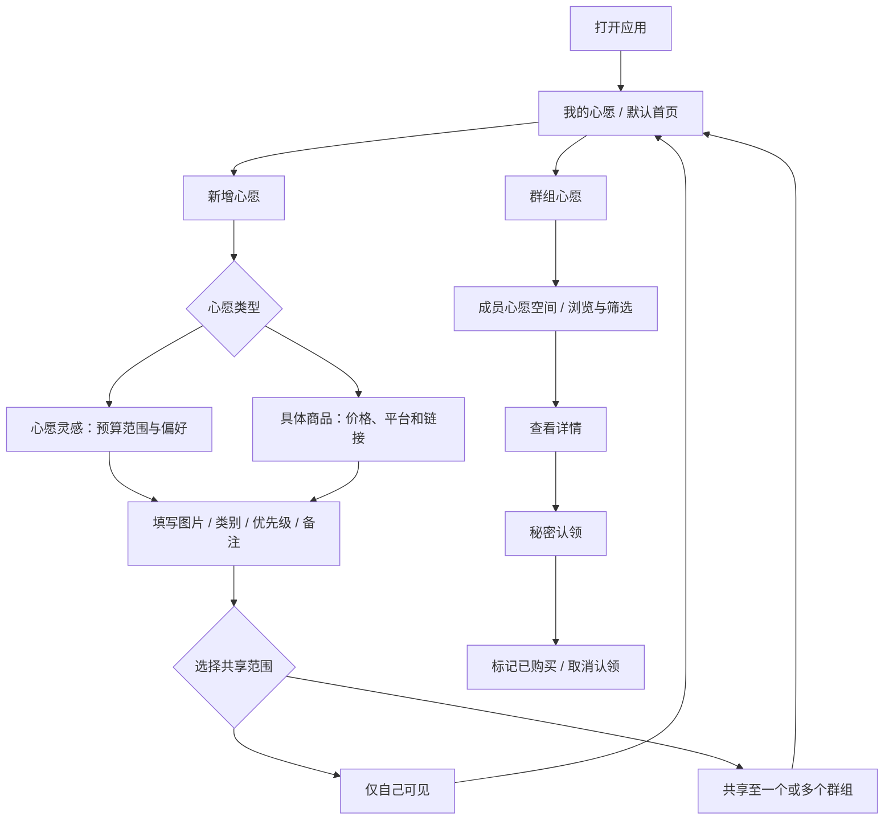

# 心愿空间 Wish Space｜产品需求文档（PRD）

> **文档版本：** PRD v1.0 · 2026-10-19  
> **对应产品：** GitHub 公开演示版 v1.0.0（`main`，核对至提交 `d6ab3b`）  
> **项目类型：** 个人产品设计与 AI 辅助开发实践；移动端优先的 Web 原型  
> **仓库：** [Amanda-QianXun/wish-space](https://github.com/Amanda-QianXun/wish-space)  
> **在线演示：** [GitHub Pages](https://amanda-qianxun.github.io/wish-space/) ｜ [ChatGPT Sites](https://wish-space-gifts.myuna8848.chatgpt.site/)  
> **文档用途：** 说明产品需求、功能规则、迭代取舍与实现边界，供项目展示、设计复盘和后续开发参考。

## 阅读说明与实现状态

本文是根据产品后期迭代讨论、仓库 README、[迭代记录](https://github.com/Amanda-QianXun/wish-space/blob/main/docs/ITERATIONS.md)、React 前端及 Supabase 脚本整理的**现状型 PRD**，不把此前讨论过的构想一律视为已经上线的功能。

| 状态         | 含义                                       |
| ---------- | ---------------------------------------- |
| **演示已实现**  | 在公开 Web Demo 或现有前端代码中能看到对应交互；默认使用本地模拟数据。 |
| **可选后端实现** | 仓库已编写相关 Supabase 数据模型、认证或接口逻辑；需要单独配置与联调。 |
| **待完善**    | 本文提出的验收规则或后续设计目标，不能当作已交付成果。              |

### 30 秒产品概览

**一句话定位：** 用一个长期积累的个人心愿库记录生活中想要的东西，再通过熟人群组为彼此提供自然、不剧透的送礼参考。

**体验路径：** 我的心愿 → 新增心愿灵感/具体商品 → 分类与排序 → 选择仅自己可见或共享群组 → 查看朋友心愿 → 秘密认领。

**已完成的主要成果：** 可交互移动端 Web Demo、个人与群组双场景、生日月历、心愿状态与图片管理、多轮交互迭代、GitHub 公开部署和版本快照；仓库另包含可选 Supabase 多账号实现代码。

---

## 1. 项目背景与产品定位

### 1.1 问题背景

在日常生活中，人们经常遇到喜欢、想要却暂时没有购买的物品：可能是不急需、价格较高，也可能只是一种尚未确定具体商品的兴趣偏好。这类想法容易散落在购物收藏夹、截图、备忘录或社交平台中，缺少一个统一、便于持续更新的个人空间。

对熟人送礼来说，临时询问“你想要什么”容易暴露送礼意图，也未必能在几句话里说明长期兴趣与具体偏好。已有的个人心愿记录若能由用户主动选择共享范围，就可以在平时服务于自己，在送礼时成为朋友自然发现需求的参考。

以上是**产品发起阶段的场景观察和需求假设**，并非经过大样本用户调研证实的结论。

### 1.2 产品定位

**心愿空间是一款以个人日常心愿记录为核心、以熟人群组共享和送礼协作为延伸的轻量 Web 工具。**

- **对自己：** 随时记录心愿灵感或具体商品，整理优先级、预算、图片、说明和实现状态。
- **对朋友：** 在被授权的群组内查看彼此长期积累的心愿，减少临时询问，获得送礼参考。
- **对送礼协作：** 通过秘密认领、已购买状态及生日信息，帮助朋友协调礼物，同时尽量保留惊喜。

### 1.3 产品原则与范围

1. **个人记录优先。** 打开应用应首先看到“我的心愿”，而不是先进入群组送礼页面。
2. **兼容模糊和明确的表达。** 不要求每条心愿都有商品链接或精准型号。
3. **由心愿所有者决定分享对象。** 记录与共享在逻辑上解耦；心愿可以仅自己可见，也可以共享至一个或多个群组。
4. **不将记录视为索要礼物。** 发布心愿不自动等于请求朋友购买。
5. **演示优先验证操作闭环。** 不以商业化、流量增长或正式上线作为当前阶段的完成标准。

**可能方向：** 电商支付/订单履约、AI 推荐算法、价格监控、社交内容分发、正式商业化运营。

---

## 2. 用户角色与关键场景

| 角色 / 状态 | 典型目标 | 主要任务 |
| --- | --- | --- |
| **个人记录者** | 保存“想要但暂时不买”的东西 | 创建、浏览、筛选、排序、编辑、标记实现/重新开启、删除心愿。 |
| **心愿共享者** | 让特定熟人了解自己的兴趣，同时保留控制权 | 选择共享群组、查看已共享范围、调整心愿。 |
| **朋友 / 送礼者** | 不通过临时询问，也能了解朋友想要什么 | 切换群组、查看成员空间、按预算和类别筛选、进入心愿详情。 |
| **礼物认领者** | 协调送礼并避免公开剧透 | 秘密认领、标记已购买、取消自己的认领。 |
| **群组成员** | 管理熟人联系与生日信息 | 创建/加入群组、查看邀请码和成员、登记生日、使用月历。 |

这些是**同一个用户在不同场景下承担的角色**，不是互斥的人群分类。

### 三个核心场景

- **日常记录：** 看到喜欢的台灯，即使现在不买，也可以记录“心愿灵感”、预算范围、图片和风格偏好。
- **熟人发现：** 朋友进入群组，查看某位成员的心愿空间，筛选合适的类别和预算后再决定是否送礼。
- **惊喜协作：** 送礼者认领一件心愿并标记已购买，其他送礼者看到协作状态，发布者在正常界面中不看到该状态。

---

## 3. 信息架构与核心使用路径

### 3.1 一级导航与默认落点

当前采用三处主要操作入口：

| 入口 | 页面职责 | 状态 |
| --- | --- | --- |
| **我的心愿** | 默认首页；个人列表、实现状态、排序/筛选、心愿详情及个人资料 | 演示已实现 |
| **居中新增（+）** | 新建或编辑心愿；按类型展示不同字段并选择分享群组 | 演示已实现 |
| **群组心愿** | 当前群组心愿、成员空间、下一位生日、群组切换与生日日历 | 演示已实现 |

个人资料通过“我的心愿”页头像进入；消息通知、生日信息及演示数据重置位于个人资料页。完整生日日历从群组页日历按钮进入。

### 3.2 主要用户路径

### 3.3 页面层级

- **我的心愿：** 头像与个人入口 → 演示身份切换（仅演示模式）→ “正在期待 / 已经实现” → 时间/优先级/预算排序 → 筛选 → 平面心愿卡片 → 详情。
- **群组心愿：** 群组切换 → 日历按钮 → 下一位生日 → 心愿状态与列表 → 成员空间/详情 → 秘密认领。
- **群组管理：** 创建群组、通过邀请码加入、查看群组成员、复制邀请码。
- **生日日历：** 月份切换、日期和头像标记、当月生日列表、登记/修改本人生日、进入成员心愿。

---

## 4. 功能需求（按当前产品实现核对）

### FR-01 心愿创建：两种表达形式（P0）

**目标：** 同时容纳“还没想好具体商品”和“已有明确购买对象”的心愿，降低临时记录负担。

**输入与规则：**

| 字段 | 心愿灵感（inspiration） | 具体商品（exact） |
| --- | --- | --- |
| 心愿名称 | 必填 | 必填 |
| 类别 | 可选设置，具有默认值 | 可选设置，具有默认值 |
| 优先级 | 1–5 星，默认 3 星 | 同左 |
| 金额 | 最低/最高预算（可选） | 参考价格（可选） |
| 偏好描述 | “喜欢什么样的”，可选 | 当前表单未单独展示此字段 |
| 购买信息 | 不要求链接 | 购买平台、商品链接（可选） |
| 图片 | 可上传、更换、移除 | 同左 |
| 备注 | 可选 | 可选 |
| 分享范围 | 仅自己可见或群组多选 | 同左 |

**已实现：** 新建及编辑表单；两类字段切换；图片与金额输入；“仅自己可见”或群组多选；保存后返回原页面。新建心愿默认仅自己可见，用户主动选择群组后才会进入对应的群组心愿列表。

**验收重点：** 必填校验准确；类型切换不产生错误字段；个人用户能理解共享范围；保存成功后可以从个人首页找到心愿。

### FR-02 个人心愿列表与生命周期（P0）

**已实现：**

- 默认进入“我的心愿”，以平面列表呈现心愿内容。
- 按“正在期待 / 已经实现”切换状态；心愿所有者可以“标记实现”或“重新开启”。
- 支持按**时间、优先级、预算**三种维度排序，每种支持正序与倒序，共六种排序方向组合。
- 支持按**类别、表达方式、预算上限、最低优先级**组合筛选，并可一键重置。
- 卡片提供图片、类型、名称、简述、参考金额、星级与添加时间等信息。
- 详情支持编辑；心愿所有者可单独删除，删除前二次确认；“标记实现”与“删除心愿”是不同操作。

**特殊说明：** 预算筛选在现有代码中使用具体商品参考价或灵感的最低预算；未填写价格时不会被预算上限过滤。这属于目前的筛选口径，不应直接宣称为经过验证的最佳方案。

**验收重点：** 状态切换可逆；排序一致；筛选与空状态正确；非所有者无法删除或编辑他人心愿。

### FR-03 图片与卡片体验（P1）

**已实现：**

- 新建/编辑时选择本地图片；上传前检查图片格式和文件大小（单张不超过 **8 MB**）。
- 前端将最长边压至不超过 **1200 px**，按 WebP 质量参数约 **0.82** 编码，降低演示中的图片数据体积。
- 支持替换、移除图片；没有图片的卡片和详情显示礼物图标占位。
- 在详情页中，将关闭按钮、星级和正文的层级分开，减少相互遮挡。

**实现边界：** 当前图片以内嵌数据形式参与保存。后续若进入真实多人场景，应评估专用对象存储、上传失败重试及存储容量；不将其宣称为已上线的图片 CDN。

### FR-04 熟人群组与成员空间（P0）

**已实现：**

- 展示所属群组、切换群组；可创建群组、查看群组详情和成员列表。
- 每组具邀请码，详情中可复制邀请码；提供“加入群组”输入入口。
- 从群组列表或生日月历进入某位成员的心愿空间，浏览该成员**在当前群组共享**且仍在期待的心愿。
- 群组与成员空间可使用统一筛选和排序控件。

**实现边界：** 公开演示版的身份和群组为本地模拟数据；“加入群组”按钮的演示模式分支尚未完成真正的跨用户成员数据加入，不能用来证明真实跨设备邀请已可用。Supabase 模式在代码中具备 `create_group` 和 `join_group` 接口，但仍需真实联调与验收。

### FR-05 心愿共享与群组差异化信息（P0 / P1）

**基本规则：** 一条个人主心愿使用 `groupIds` 标记共享到哪些群组；当该数组为空时，心愿仅自己可见。群组成员只能在授权群组中读取相应心愿，用户编辑时可调整共享范围或取消全部群组共享。

**部分实现：** 数据模型提供 `GroupOverride`，支持按群组覆写**购买平台、链接、价格及备注**；详情页会应用相应覆写值。

**待完善：** 当前新增/编辑表单尚无完整的“逐群组修改字段”操作入口。**“群组字段级覆写”应表述为已设计、数据结构部分支持，而不是一个已经完整交付给用户操作的功能。**

**需要明确的规则：** 主心愿更新时哪些字段继承，取消共享时认领记录如何处理，以及跨群组同一心愿是否共享认领状态。

### FR-06 秘密认领与已购买（P0）

**目标：** 为朋友提供协调送礼的工具，同时降低对心愿发布者的提前剧透。

**已实现的演示流程：**

1. 群组成员在他人的心愿详情选择“秘密认领”。
2. 认领状态分为 `reserved`（已认领）与 `purchased`（已购买）。
3. 认领者可以标记已购买或取消认领。
4. 目前心愿发布者的常规详情与卡片界面不显示认领状态及认领操作。
5. 仓库 Supabase 脚本建立了非所有者读取认领记录的相关访问限制，并阻止所有者认领本人心愿。

**重要边界：** 演示模式的数据都位于本地浏览器，身份切换只用于演示多角色交互，**不是后端级权限保护**。此外，已有认领后的“由谁可以变更认领”的前端交互及跨群组冲突处理仍需专项测试；不能仅凭 Demo 宣称这些边界完全安全。

**验收重点：** 本人不能认领自身心愿；不同送礼者无法越权覆盖别人的认领；并发认领不产生重复结果；发布者无法通过正常账号接口读取隐藏记录。

### FR-07 生日与月历（P1）

**已实现：**

- 群组首页显示**下一位过生日的其他成员**和对应日期。
- 提供完整月历：月份切换、日期选择、生日头像标记、当月生日列表和“今天”跳转。
- 生日月历对用户已加入群组的成员做跨群去重，减少同一人出现在多个群组时的重复显示。
- 可以登记或修改本人生日；点击生日成员可进入其心愿空间。
- 群组详情也展示成员生日及心愿数量。

**边界：** 生日输入存储完整日期用于处理，但界面主要显示月日；跨群汇总的隐私范围应在真实账号场景中验证。

### FR-08 个人资料与消息入口（P2）

**已实现的演示界面：** 个人头像与昵称入口、心愿数量、生日信息、消息通知入口与未读角标；演示模式提供“重置体验数据”，登录模式可退出账号。

**实现边界：** 当前消息列表包含预设演示事件（加入群组、登记生日）；未读数量主要用于界面演示，尚无完整事件驱动的消息持久化、订阅与推送机制。个人设置页目前为占位内容。

---

## 5. 权限、数据与技术架构

### 5.1 核心数据对象

| 实体 | 核心字段/含义 | 关系 |
| --- | --- | --- |
| `Profile` | 用户 ID、昵称、头像配色、生日 | 可加入多个群组，拥有多条心愿。 |
| `Group` | 群组 ID、名称、标识、邀请码、成员 | 提供熟人分享边界。 |
| `Wish` | 标题、类型、状态、优先级、类别、预算/价格、平台/链接、备注、图片、创建时间 | 归属于一个用户，可共享至多个群组。 |
| `GroupOverride` | 群组 ID 与平台、链接、价格、备注的覆写信息 | 对共享心愿进行部分群组差异化展示。 |
| `GiftClaim` | 心愿 ID、群组 ID、认领者 ID、认领状态 | 建立送礼协调关系。 |

真实后端的数据表还包含 `group_members`、`wish_groups` 等关联表。详见仓库 [`src/types.ts`](https://github.com/Amanda-QianXun/wish-space/blob/main/src/types.ts) 和 [`supabase/migrations`](https://github.com/Amanda-QianXun/wish-space/tree/main/supabase/migrations)。

### 5.2 技术实现

- **前端：** React 19、TypeScript、Vite、Lucide React。
- **默认公开演示：** 本地虚构数据，借助浏览器 `localStorage` 保存演示操作和当前演示身份；同一浏览器可以重置体验数据。
- **可选多账号模式：** Supabase 客户端、邮箱 Magic Link、PostgreSQL 表、行级安全策略（RLS）和用于主要业务操作的 RPC。
- **部署：** GitHub Actions 构建并部署 GitHub Pages；另提供 ChatGPT Sites 演示入口。

> **状态区分：** 仓库已经包含后端代码、SQL 权限与迁移脚本，但公开站点默认不依赖 Supabase。是否能够稳定支持真实多账号、跨设备共享及并发操作，需要在配置数据库之后完成端到端测试。

### 5.3 权限需求

| 行为 | 本人 | 同群其他成员 | 非同群成员 |
| --- | --- | --- | --- |
| 查看个人创建的心愿 | 允许 | 仅可看共享到共同群组的内容 | 不允许读取私有内容 |
| 编辑/删除主心愿 | 允许 | 不允许 | 不允许 |
| 标记自己的心愿已实现 | 允许 | 不允许 | 不允许 |
| 认领本人心愿 | 不允许 | — | — |
| 秘密认领他人心愿 | — | 在权限与状态满足时允许 | 不允许 |
| 查看秘密认领信息 | 心愿所有者不可见 | 按群组和认领权限控制 | 不允许 |

上述权限是**产品验收要求**；公开演示仅能展示部分角色规则，不代替真实后端授权测试。

---

## 6. 典型验收场景与边界处理

| 场景           | 预期行为                  | 当前状态                 |
| ------------ | --------------------- | -------------------- |
| 用户打开网站       | 默认进入“我的心愿”            | 演示已实现                |
| 用户添加“心愿灵感”   | 可以填写预算区间与偏好，不强制商品链接   | 演示已实现                |
| 用户添加“具体商品”   | 可填写参考价、平台、链接与图片       | 演示已实现                |
| 用户不选择任何群组    | 心愿仅出现在“我的心愿”，不进入群组列表  | 演示已实现                |
| 未上传图片        | 列表与详情呈现默认占位图          | 演示已实现                |
| 所有者标记实现/重新开启 | 在两种列表状态之间正确切换         | 演示已实现                |
| 所有者删除心愿      | 必须二次确认；其他成员不得删除       | 演示已实现；后端函数已有本人限制     |
| 用户切换排序/筛选    | 正反排序及条件筛选正确更新结果       | 演示已实现                |
| 朋友查看群组心愿     | 仅展示当前群组被共享的内容         | 演示路径已实现；后端待验收        |
| 用户通过邀请码加入新群  | 跨账号建立真实成员关系           | 后端代码具备接口；演示模式不支持真实加入 |
| 朋友秘密认领       | 所有者看不到，其他送礼者避免冲突      | 常规界面可演示；并发与越权待验收     |
| 修改共享群组后的原认领  | 按明确策略保留、转移或取消认领，并说明后果 | **待完善：需定义数据生命周期**    |
| 进入消息中心       | 展示与账号相关的真实通知          | 目前为示例消息，待实现          |

---

## 7. 迭代记录与关键产品取舍

这些里程碑保留**结构性迭代**，不将每次字号、间距或图标修正都单独视为一个重大版本。

| 里程碑               | 方向             | 主要完成内容                                                |
| ----------------- | -------------- | ----------------------------------------------------- |
| **v0.3 · 核心原型**   | 验证记录与熟人分享的基本构想 | 两类心愿、群组创建与分享、秘密认领/已购买、多账号数据结构草案。                      |
| **v0.6 · 群组与生日**  | 让熟人浏览和生日信息更清晰  | 成员空间、生日日历、类别/预算/优先级筛选、群组详情和邀请码。                       |
| **v0.9 · 个人心愿优先** | 明确个人记录是主场景     | 默认个人首页、个人与群组分区、详情编辑、商品图片与更轻的列表。                       |
| **v1.0 · 交互体验收口** | 精简信息层级并降低操作成本  | 六种排序方向、消息入口、筛选和状态控件统一、细节修正、GitHub Pages 自动部署。         |
| **v1.0 后续补充**     | 补全内容管理与交互边界    | 图片上传/更换/移除及压缩、简化无图占位、仅自己可见、关闭按钮布局修正、所有者删除心愿和确认提示、删除权限 SQL 迁移。 |

**关键取舍：** 早期界面较强调群组和近期生日，后期将默认首页改为“我的心愿”，群组成为第二场景。这是产品价值重心调整，不只是导航按钮换位。

对应代码快照及更多说明见 [`docs/ITERATIONS.md`](https://github.com/Amanda-QianXun/wish-space/blob/main/docs/ITERATIONS.md)。

---

## 8. 验证计划与评价方式

### 8.1 目前已经完成什么

- 完成可访问的演示网页和多角色模拟路径。
- 通过原型自测进行了页面结构、列表呈现、入口与筛选方式的多轮修改。
- 已建立部分后端数据结构与权限设计，并记录关键版本里程碑。

目前没有经核验的访谈人数、独立用户数、留存率、付费转化率、可用性成功率或 A/B 实验效果。

### 8.2 如进入真实多人试用阶段

优先考虑：实际新增心愿数、无群组场景记录率、共享意愿、群组邀请成功率、朋友心愿浏览与认领发生情况、认领冲突/越权错误数。对于这类低频场景，不应机械以日活作为唯一成功标准。

---

## 9. 后续开发优先级（未完成事项）

| 优先级    | 待解决问题                     | 价值 / 原因                                               |
| ------ | ------------------------- | ----------------------------------------------------- |
| **P0** | 验收真正的跨账号邀请、群组成员变化与数据隔离    | 区分可交互 Demo 和真实协作功能。                                   |
| **P0** | 明确认领归属、跨群组重复认领、并发争抢与取消规则  | 防止送礼冲突和越权操作。                                          |
| **P0** | 修正共享范围编辑对已有认领记录的影响        | 当前后端 `update_wish` 会重建共享关系，可能连带移除关联认领，需要设计并测试保留/清理策略。 |
| **P1** | 提供逐群组编辑平台、价格、链接、备注的操作入口   | 把已有 `GroupOverride` 数据设计真正转化为可用功能。                    |
| **P1** | 明确缺少价格时的预算筛选策略、数字输入验证和边界值 | 提升筛选结果的可解释性。                                          |
| **P1** | 在真实后端模式下验证图片持久化策略         | 避免把内嵌图片长期作为大量用户的存储方案。                                 |
| **P2** | 实现真实通知、已读状态及必要的消息触发       | 替换目前预设消息界面。                                           |
| **P2** | 结合实际用户反馈决定是否增加新的收藏入口或分享方式 | 避免为了功能数量而扩大需求范围。                                      |

**后续可能方向：** 正式商业发布、AI 商品推荐、电商支付对接、大规模用户增长。

---

## 10. 交付说明与作品集入口

### 已交付（以仓库为依据）

- 移动端优先的 React + TypeScript 可交互 Web 原型。
- 个人心愿、群组心愿、成员空间、两类心愿、多条件筛选与双向排序、生日月历、秘密认领等主要演示路径。
- 图片上传/处理、心愿编辑、实现状态与仅本人删除的页面流程。
- GitHub 公开仓库、部署工作流与分阶段里程碑记录。
- 供后续真实多账号实现参考的 Supabase 数据结构、RPC 与权限脚本。

### 项目展示建议

面试或作品集浏览时，可从**个人首页记录一条心愿**开始，演示仅自己可见与群组共享的区别，再转入**群组内查看朋友心愿**，最后通过**演示身份切换**查看秘密认领的不同角色表现。这样更能呈现产品的完整逻辑：**日常记录 → 有选择地共享 → 熟人自然发现 → 送礼协作**。

### 项目性质与真实性说明

这是一个持续迭代的**独立产品原型项目**。当前版本的主要价值在于需求拆解、信息架构、业务规则、交互迭代和 AI 辅助原型开发实践；其商业可行性、真实用户需求强度及线上协作效果尚未得到数据验证。

---

## 参考资料（仓库内源文件）

- [README｜版本说明与运行方式](https://github.com/Amanda-QianXun/wish-space/blob/main/README.md)
- [ITERATIONS｜产品里程碑](https://github.com/Amanda-QianXun/wish-space/blob/main/docs/ITERATIONS.md)
- [App.tsx｜核心页面与交互](https://github.com/Amanda-QianXun/wish-space/blob/main/src/App.tsx)
- [types.ts｜数据对象定义](https://github.com/Amanda-QianXun/wish-space/blob/main/src/types.ts)
- [backend.ts｜可选 Supabase 接口](https://github.com/Amanda-QianXun/wish-space/blob/main/src/lib/backend.ts)
- [supabase/migrations｜数据库与权限脚本](https://github.com/Amanda-QianXun/wish-space/tree/main/supabase/migrations)

*本文档对应 2026 年 10 月 19 日核对的仓库版本；后续产品变化应同步修订 PRD 和状态表。*
